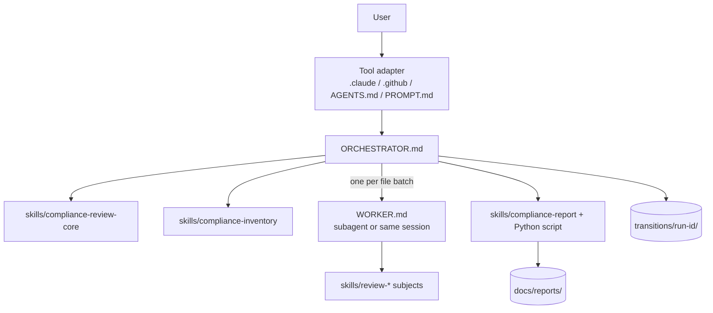

# Compliance Reviewer

An AI-provider-neutral skill set that reviews a codebase you point it at — architecture, coding standards, security, testing, operations and more — and produces a single scored Markdown report. It never modifies the code it reviews. It works with Claude Code, GitHub Copilot, ChatGPT/Codex and any other AI tool that can read files, without moving or reordering files per provider.

## Design

All real content lives once, in the neutral [compliance-reviewer/](./compliance-reviewer) folder. Each AI tool reaches it through a tiny adapter file in the location that tool already auto-discovers. Adapters only say "read `compliance-reviewer/ORCHESTRATOR.md`" and map generic capabilities (ask the user, delegate to a worker, shell, todo list) to that tool's names. Nothing in the neutral folder names a specific vendor tool except the capability-mapping table.

Flow: the orchestrator inventories the target and gives each subject a capped list of files (max 12). Subjects with mostly overlapping lists are batched. Each batch goes once to the worker, which loads the applicable `review-*` skills, reads the files once, and writes one transition file per subject, returning only a short status. A deterministic Python script validates, aggregates and renders the report (no model tokens). Transition files make interrupted runs resumable. If the tool has no subagents, the orchestrator performs the worker procedure itself (documented fallback).



## Files

| Path | Role |
|------|------|
| `compliance-reviewer/ORCHESTRATOR.md` | Neutral orchestrator instructions, operational flags, programmatic mode, capability mapping, no-subagent fallback |
| `compliance-reviewer/WORKER.md` | Neutral worker instructions |
| `compliance-reviewer/PROMPT.md` | Paste-in prompt for chat tools with no repo integration |
| `compliance-reviewer/STANDARDS-MAINTENANCE.md` | Maintainer guide: how the localized standards are kept current (cadence, triggers, refresh steps, drift checker, AI-tool usage) |
| `compliance-reviewer/REFRESH.md` | Neutral procedure for the maintainer-only standards refresh command |
| `scripts/run_review.py` | Runs a review headlessly against an application directory, prints the report, then the run's duration, cost and token costs ([details](#running-a-review-from-a-script)) |
| `compliance-reviewer/scripts/check_source_drift.py` | Maintainer-only drift checker: compares each skill's `references/standards/pins.json` with the live sources (never run during a review) |
| `.claude/skills/refresh-standards/SKILL.md`, `.github/prompts/refresh-standards.prompt.md` | Refresh command adapters (Claude Code, GitHub Copilot) |
| `compliance-reviewer/skills/compliance-review-core/` | Schemas, scoring rubric, maintainer-only source registry, resume rules |
| `compliance-reviewer/skills/compliance-inventory/` | Repo mapping, capped per-subject file lists, batching |
| `compliance-reviewer/skills/review-*/` | One folder per subject (18): checklist, sources, optional per-language files |
| `compliance-reviewer/skills/compliance-report/` | Validate/aggregate/render script (`scripts/compliance_report.py`, Python 3) and report template |
| `AGENTS.md` | Auto-read by Codex/ChatGPT agents and many other tools (agents.md convention) |
| `.claude/skills/compliance-reviewer/SKILL.md`, `.claude/agents/compliance-subject-reviewer.md`, `.claude/settings.json` | Claude Code adapters and pre-approved permissions |
| `.github/prompts/compliance-review.prompt.md`, `.github/agents/compliance-subject-reviewer.agent.md` | GitHub Copilot adapters |
| `transitions/<run-id>/` | Per-run transition files and `state.json` (resumable) |
| `docs/reports/` | Final scored reports |

## Using it with each AI tool

- **Claude Code** — run `/compliance-reviewer <path-to-target>` (or ask for a compliance review). The skill adapter loads the orchestrator; the worker runs as the `compliance-subject-reviewer` subagent. `.claude/settings.json` pre-approves writes to `transitions/` and `docs/reports/` and the report script. For a target outside this workspace use `--add-dir <path>` or `/add-dir <path>`.
- **GitHub Copilot (VS Code / CLI / agent mode)** — run the prompt `/compliance-review <path-to-target>`, or ask in agent mode. The worker is the custom agent `compliance-subject-reviewer`, invoked as a subagent. Copilot also reads `AGENTS.md` and `.github/copilot-instructions.md`. Note: recent VS Code versions also discover `.claude/` agents/skills, so the adapters may appear twice; both point at the same neutral files.
- **ChatGPT / OpenAI Codex** — Codex-style agents read `AGENTS.md` automatically; ask for a compliance review. They normally lack subagents, so the orchestrator's fallback runs each batch in-session. For ChatGPT web, upload the `compliance-reviewer/` folder and the target code, then paste the prompt from `compliance-reviewer/PROMPT.md`. If it cannot write files or run Python, it returns the transition JSON in chat and you run `python compliance-reviewer/skills/compliance-report/scripts/compliance_report.py validate|aggregate|render` yourself.
- **Any other AI tool** — point it at `AGENTS.md` or paste `compliance-reviewer/PROMPT.md`. Needs: file read/search, file write (or manual copy-out), optionally shell. No URL fetch is needed, because reviews never read external sources. To add native support, create a small adapter in that tool's discovery location that says "read `compliance-reviewer/ORCHESTRATOR.md`" — do not copy the content.

## Usage

1. Start the review as above, naming the target (read-only; may be outside this workspace), optionally followed by [operational flags](#operational-flags).
2. With no flags, you are interviewed: confirm "all" or a subset of subjects, and choose whether to turn on advanced usage (IaC review and CLI analyzers; off by default). Coding Standards is part of Software Quality. Disaster Recovery, Monitoring and Cost & Sustainability are N/A unless advanced usage is on and the target has infrastructure-as-code. MCP Server is N/A unless the target contains a Model Context Protocol server (see [Reviewing MCP servers](#reviewing-mcp-servers)).
3. With advanced usage on, pick the CLI analyzers to run (`dotnet list package --vulnerable/--deprecated/--outdated`, `mvn dependency:tree`, `gradle dependencies`, OWASP Dependency-Check for Maven/Gradle, `pip-audit`, linters); otherwise only files are read.
   Reviews judge only the target's working files. "Committed" or "in the repository" in any check means "present in the working files"; the only Git command a review runs is `git -C <target> rev-parse HEAD`, to record `targetGitHead`.
4. Reviews never fetch URLs: every subject uses the standards stored in this repo. `compliance-reviewer/skills/compliance-review-core/references/approved-sources.md` lists the source pages that maintainers use to refresh them.
5. The final message links to the report under `docs/reports/`.

## Reviewing MCP servers

A Model Context Protocol (MCP) server in C#, Java or Python is reviewed through the same pipeline as any other target, with one extra subject, `review-mcp-server` (step 28). It is a separate subject, not part of API Design, because MCP tools are JSON-RPC operations described by JSON Schema rather than HTTP resources, and a stdio server has no HTTP surface at all.

- **Detection.** The inventory looks for an MCP SDK (`ModelContextProtocol` NuGet package, `io.modelcontextprotocol.sdk` or Spring AI MCP server starters, Python `mcp` or `fastmcp`) plus server code, and records each server's language, SDK and transports in `01-inventory.json` (`mcpServers`). With none found, MCP Server is N/A.
- **What it checks** (MCP-01 … MCP-16): `stdout` used only for protocol messages on stdio, cancellation and shutdown, the transport fitting the deployment, tool names and schemas, tool-description integrity (tool poisoning), input validation, `isError` results, output sanitization, least privilege (no general shell, any-file or any-URL tools), annotations and confirmation for destructive tools, credentials, state handles, rate limits and timeouts, per-invocation audit logging, HTTP-transport security, and versioning. Sources: the MCP specification (revision 2026-07-28), the MCP Security Best Practices and Local Server Security guides, the modelcontextprotocol.info best practices, the CSA Agentic MCP Security guide and (partly) The New Stack's 15 best practices; see `skills/review-mcp-server/references/sources.md`.
- **Other subjects still apply.** Tool handlers count as request handlers for the security, observability, reliability and performance subjects. A stdio-only server has no HTTP surface, so API Design and Security — Web & API are N/A for it, and Twelve-Factor accepts logs on `stderr` (where `stdout` is the protocol channel).
- **Transports.** stdio is covered by the test apps under [`test/mcps/`](../test/README.md#mcp-servers). The HTTP-transport checks (MCP-15) are in the checklist but not yet validated by a test app.

## Operational flags

Flags go after the target path, in any order: `--name value` or `--name=value`. A boolean flag given bare means `on` (it also accepts `=on|off|true|false`). Lists are comma-separated with no spaces. The authoritative definition is the "Operational flags" section of [ORCHESTRATOR.md](ORCHESTRATOR.md).

| Flag | Values | Default | What it does |
|------|--------|---------|--------------|
| `--subjects` | `all`, or skill names (e.g. `review-testing,review-security-web-api`) | `all` | Which subjects to review. Positional subjects after the target path mean the same. |
| `--advanced` | boolean | `off` | **Advanced usage.** Off: infrastructure-as-code is not reviewed at all. The inventory doesn't look for IaC (Bicep, Terraform, ARM, CloudFormation/SAM, Pulumi, Kubernetes, Helm, Kustomize), no subject receives IaC files, Disaster Recovery, Monitoring and Cost & Sustainability are N/A, and no CLI analyzer runs. On: IaC is reviewed and the analyzers chosen by `--analyzers` run. |
| `--analyzers` | `auto`, `none`, or analyzer keys | `auto` | Which CLI analyzers run when `--advanced` is on (ignored otherwise). `auto` runs every applicable, installed analyzer except OWASP Dependency-Check (downloads a large database) and `lint` (runs the target's own scripts); name those to include them. Keys: `dotnet-vulnerable`, `dotnet-deprecated`, `dotnet-outdated`, `maven-tree`, `gradle-tree`, `maven-dependency-check`, `gradle-dependency-check`, `pip-audit`, `lint`. Auto-set analyzers may still contact their package registry. |
| `--programmatic` | boolean | `off` | **Programmatic execution** for scripts and pipelines; see below. |
| `--output` | `text` or `file` | `text` | Programmatic mode only. `text`: the response is the full report text. `file`: the report is written to `--out-file` and the response is one line of JSON. |
| `--out-file` | path | none | Also write the report to this path (any folder except inside the target; relative paths resolve against the repository root). Required with `--output file`; in programmatic mode it implies `--output file`. Works in interactive mode too. |
| `--readme` | boolean | `off` | Return this README instead of running a review. No target needed; other flags are ignored. |

**How flags are resolved.**

- **No flags at all** (interactive): you're interviewed for subjects and advanced usage, and, if advanced is on, for analyzers once the inventory shows which apply.
- **Any flag given**, or `--programmatic`: no interview. The flags you gave are used and every other flag takes its default. Passing `--advanced` approves the resolved `--analyzers` set.
- `--subjects`, `--advanced` and `--analyzers` are stored with the run (`state.json` `flags`) and are part of its inputs hash, so a resumed run keeps them. The other flags apply only to the current invocation.
- The report appendix shows the run flags. Scores from runs with advanced usage off and on aren't directly comparable: with it off, IaC-dependent checks are N/A and three subjects are skipped.

**Programmatic mode (`--programmatic`).**

- No user interaction: no interview, questions, confirmations, resume offer or analyzer approval. Anything that would need an answer uses the flags and defaults; if there is no default (missing target, invalid flag, changed inputs on resume, a subject that fails twice), the run fails.
- No chat: no status lines, progress messages or todo list. The only output is the response:
  - `--output text`: the report Markdown, verbatim, and nothing else.
  - `--output file`: `{"status":"completed","runId":"…","reportFile":"<absolute path>","overallScore":<n>,"overallBand":"…"}`.
  - On failure (either output): `{"status":"failed","runId":"…|null","step":"…|null","error":"…"}`.
- Unfinished runs are ignored unless you pass `resume run <id> [from step <NN>]`.
- Transition files and the copy under `docs/reports/` are still written. For large reports, `--output file` is more reliable than `text`, because `text` mode has the model repeat the whole report.

**Examples.**

```text
/compliance-reviewer ../myapp                                        # interview
/compliance-reviewer ../myapp --subjects review-testing,review-maintainability
/compliance-reviewer ../myapp --advanced --analyzers dotnet-vulnerable,lint
/compliance-reviewer --readme
```

Claude Code, unattended (PowerShell). `--add-dir` gives read access to the target; Write must be allowed when `--out-file` is outside the pre-approved folders, and Bash for analyzers and `git rev-parse` (otherwise `targetGitHead` is recorded as `null`):

```powershell
claude -p "/compliance-reviewer C:\src\myapp --programmatic --output file --out-file C:\out\myapp-review.md" `
  --add-dir C:\src\myapp --add-dir C:\out --allowedTools "Read,Grep,Glob,Write,Agent,Bash(git -C:*)"
claude -p "/compliance-reviewer C:\src\myapp --programmatic --subjects all" --add-dir C:\src\myapp > review.md
claude -p "/compliance-reviewer --readme --programmatic"
```

Other tools: pass the same text to the tool's non-interactive mode (for example a Codex `exec` prompt) as "Run a compliance review: `<target> --programmatic …`"; `AGENTS.md` routes it to the orchestrator.

## Running a review from a script

[`scripts/run_review.py`](../scripts/run_review.py) runs a complete review headlessly against an application directory that you name, then shows the report and a summary of the run's duration and cost. It wraps the programmatic-mode commands above, so you don't need to work out the `--add-dir`, `--allowedTools` and `--out-file` arguments yourself.

**Prerequisites.** Python 3.10+ (standard library only), and the CLI of the AI tool you use, signed in: Claude Code (`claude`) or GitHub Copilot CLI (`copilot`, from `npm install -g @github/copilot`; the `copilot` shim that VS Code puts on the path isn't enough on its own).

**Usage.** Run it from any folder; the review always runs with `compliance-reviewer_any-ai` as the working directory.

```powershell
python scripts/run_review.py C:\src\myapp                                   # all subjects, AI tool chosen automatically
python scripts/run_review.py C:\src\myapp --tool copilot --model gpt-5      # a given tool and model
python scripts/run_review.py ..\myapp --subjects review-testing,review-maintainability
python scripts/run_review.py C:\src\myapp --out-file C:\out\myapp-review.md --no-report
python scripts/run_review.py C:\src\myapp --summary-json C:\out\myapp-run.json
python scripts/run_review.py C:\src\myapp --dry-run                         # show the command, don't run it
```

**What it does.**

1. Picks the AI tool. The first rule that applies wins: `--tool claude|copilot`; the `COMPLIANCE_REVIEW_TOOL` environment variable; started from Claude Code: Claude; started from elsewhere in VS Code (such as Copilot Chat or a VS Code terminal): Copilot; otherwise Claude.
2. Runs `/compliance-reviewer <target> --subjects … --programmatic --output file --out-file …` with that tool. A target outside this workspace is passed with `--add-dir`. Claude runs with a fixed `--allowedTools` list (read, write, subagents, `git -C` and the report script); Copilot runs with `--allow-all-tools`. The reviewer's own rules keep the target read-only.
3. While the review runs, prints a progress line to stderr each time the reviewer finishes a step (read from `transitions/<runId>/state.json`), and a heartbeat every `--progress` seconds.
4. Prints the report (Markdown) to stdout. The report is also saved under `docs/reports/` as usual, and at `--out-file` if you gave one.
5. Prints a **run summary**: status, run ID, overall score and band, report path, wall-clock duration, and cost:
   - **Claude:** the `total_cost_usd` reported by Claude Code, API time, turns and subagent count. The cost is at API list prices; on a subscription plan you're billed differently.
   - **Copilot:** the premium requests Copilot CLI reports, an estimated dollar cost at `--copilot-request-usd` per request (default `0.04`), and Copilot's own usage block. Requests included in your plan cost nothing extra. If the tool doesn't report usage, the summary says so.
6. Prints the **token costs**: for each model the run used, a table of the four token types (input, output, cache read, cache write) with the token count, the price per million tokens, the cost and its share of the model's cost, then a total.
   - Prices come from a table of Anthropic API list prices in the script (`MODEL_PRICES`, dated in a comment). Model names are matched by prefix, so `claude-opus-4-8[1m]` and `claude-sonnet-4.5` are found. Replace or add prices with `--prices FILE`.
   - **Cache writes** cost more for a 1-hour cache than for a 5-minute one, and neither tool reports which was used. With Claude, the script takes the cache-write cost as the part of the model's reported cost that input, output and cache reads don't explain, provided it lies between the all-5-minute and all-1-hour cost, and marks it `*`. Otherwise it uses the 5-minute price and marks it `+`. The total row shows the reported cost when the two differ.
   - **Copilot** bills premium requests, not tokens, so its token costs are what the same tokens would cost at API list prices, for comparing runs and tools. A model with no price on file (for example a GPT model) is listed with its token counts only.

A `--prices` file is JSON keyed by model name, in USD per million tokens. Cache prices you leave out default to 0.1× (read), 1.25× (5-minute write) and 2× (1-hour write) the input price:

```json
{
  "claude-opus-5-5": { "input": 4, "output": 20, "cacheRead": 0.2, "cacheWrite5m": 5, "cacheWrite1h": 8 },
  "gpt-5": { "input": 1.25, "output": 10 }
}
```

**Options.**

| Option | Default | What it does |
|--------|---------|--------------|
| `target` | required | Application code directory to review. Read-only; may be outside this workspace, but must not be or contain this workspace. |
| `--tool auto\|claude\|copilot` | `auto` | AI tool that runs the review (see step 1). |
| `--model NAME` | tool default | Passed to the tool's `--model` option. |
| `--subjects`, `--advanced`, `--analyzers` | `all`, off, `auto` | Passed to the reviewer as the [operational flags](#operational-flags) of the same name. |
| `--out-file PATH` | none | Also keep the report at this path (not inside the target). Without it, the report is kept only under `docs/reports/`. |
| `--no-report` | off | Don't print the report; print only the run summary. |
| `--summary-json PATH` | none | Also write the run summary (status, duration, cost, tokens, token costs) as JSON. |
| `--prices FILE` | built-in table | JSON file of per-million-token prices that replace or extend the built-in table (see above). |
| `--timeout MIN` | `60` | Time limit for the review. Also `COMPLIANCE_REVIEW_TIMEOUT_MIN`. |
| `--progress SEC` | `30` | Heartbeat interval for progress lines; `0` turns progress output off. |
| `--copilot-request-usd USD` | `0.04` | Price per Copilot premium request, used for the cost estimate. |
| `--allow-tool RULE` | none | Claude only: add a rule to the allowed-tools list, e.g. `"Bash(dotnet list:*)"`; repeat for more. |
| `--tool-arg ARG` | none | Extra argument for the AI tool's CLI; repeat for more, e.g. `--tool-arg=--max-budget-usd --tool-arg=5`. |
| `--dry-run` | off | Print the tool, working directory and command, then stop. |

**Exit codes:** `0` the review completed, `1` the reviewer reported a failure, `2` the review couldn't run (tool not found, invalid target, timeout, or no status line from the tool). On `1` or `2` the summary names the error and the log file holding the tool's raw output (under the system temp folder, `compliance-review-runs/`). If a run is interrupted, resume it in the AI tool with `resume run <id>`.

**Notes.**

- A review takes several minutes and uses model credit, roughly the same as running `/compliance-reviewer` yourself.
- With `--advanced` under Claude, the CLI analyzers need shell commands that the fixed `--allowedTools` list doesn't include, so they're denied. Allow the ones you want with `--allow-tool`, for example `--allow-tool "Bash(dotnet list:*)"`.
- The test harness in [`test/logic/`](../test/README.md#automated-validation) uses the same approach to run and score the reviewer against the sample apps.

## Resuming After an Interruption

- On startup the orchestrator lists unfinished runs under `transitions/` and offers to resume the latest.
- `resume run <id>` continues from the first step not `completed`.
- `resume run <id> from step <NN>` moves transition files from step `NN` onward to `transitions/<id>/superseded/` and re-runs them (e.g. `resume run 2026-09-26_1420-myapp from step 15`).
- If the target's git HEAD or inputs changed, you are asked whether to continue, restart or abort.

## Known coverage gaps

No subject judges these topics today (recorded by the cross-skill follow-up review, 2026-11-09):

- **Edge DDoS protection and WAF rules** in IaC. Reliability excludes them and no security subject checks them. Suggested owner when needed: `review-security-web-api` (edge config) or `review-monitoring`.
- **Network egress controls and cloud metadata settings (e.g. IMDSv2)** as SSRF defense in depth in IaC. SSRF in code is judged by Input & Injection (SEC-II-10).
- **Structured analyzer results** (`02-analyzers.json` keeps free-text `findings`; deferred by decision D-7).
- **Repository-wide debt-marker counts.** MAINT-04/05 judge only the files the subject receives.
- **Penetration testing** (testing follow-up F-6).
- **Vulnerable library versions without analyzer output.** DEP-03 is analyzer-only, so with no approved analyzer (always the case with advanced usage off) no subject reports them (add `no-analyzer-output` to `notes`).
- **MCP servers over HTTP.** MCP-15 (remote transport security) is localized but no test app exercises it yet; the MCP test apps use stdio only.
- **Infrastructure-as-code with advanced usage off** (the default). IaC files aren't reviewed by any subject; turn on `--advanced` to include them.

## Keeping the standards current

Every subject reviews against local, pinned summaries of its external sources (`references/standards/`), so those summaries must be refreshed as the sources change. The strategy is documented centrally in [STANDARDS-MAINTENANCE.md](STANDARDS-MAINTENANCE.md); each skill's `references/standards/MAINTENANCE.md` holds its source-specific detail.

- **When:** on each skill's schedule (quarterly, six-monthly or yearly), within two weeks of pinned vendor releases, on dated "Refresh due" entries, and when reviews leave 3 or more `localized-standard-gap` notes or any `localized-standard-stale` note for a skill.
- **How:** in a maintenance session (never during a review): collect the notes from `transitions/`, detect drift against the recorded pins, update elements (new IDs only, never reuse one), re-verify coverage and run a sample review, then log the change and add a score-comparability note below if checks changed.
- **Usage:** run the refresh command: `/refresh-standards all` (drift report only), `/refresh-standards all gaps` (collect review notes) or `/refresh-standards <skill>` (full refresh; nothing is edited before you approve the change list). In Claude Code and Copilot it's a slash command; other tools follow `AGENTS.md` to `REFRESH.md`. Fetching is allowed only in that session, and only for the pages listed in `approved-sources.md`.
- **Drift checker on its own:** `python compliance-reviewer/scripts/check_source_drift.py check [skill ...]` reports which pinned sources changed; `lint` checks the `pins.json` manifests offline. Set `GITHUB_TOKEN` for repeated full runs (GitHub allows 60 unauthenticated API calls an hour).

## Maintenance

- **Edit content only under `compliance-reviewer/`.** Adapters should stay a few lines; keep all rules in the neutral files so every provider stays in sync.
- **Add a subject:** create `compliance-reviewer/skills/review-<name>/` with `SKILL.md`, `references/checklist.md`, `references/sources.md`; add it to the subject table in `ORCHESTRATOR.md`, the step table in `transition-schema.md`, `subject-file-map.md` and `approved-sources.md`. The checklist needs a `Subject:` line after its H1 and a `Sub-subject` for every check; run `python compliance-reviewer/skills/compliance-report/scripts/compliance_report.py labels` after editing any checklist. Labels are stable like check IDs: change one only in a dated, recorded edit, with a score-comparability note below if it moves a check to another subject.
- **No review-time fetching (since 2026-11-09).** Reviews never fetch URLs. The fetch tool was removed from the worker and the Copilot prompt, `WORKER.md` forbids fetching for every skill, and `approved-sources.md` became a maintainer-only registry that the orchestrator and workers don't load. Since Twelve-Factor was localized the same day, every subject reviews against its local standards; a subject added without them would review against its checklist and cite URLs without fetching them.
- **Localize a subject's standards** (the way to add or refresh standards, since reviews never fetch):
  - Summarize each source website into `references/standards/<source>.md`: a pinned version or commit, a citation base URL, and one row per element (stable ID, the source's own level wording, a summary, an "applies when" condition, source anchors). Keep each site to at most 100 elements per skill per website unless the skill's `MAINTENANCE.md` records an approved exception.
  - Declare the files in the skill's `SKILL.md` under `## Standards (local, authoritative)`. List the exact source pages in that subject's section of `approved-sources.md`, as maintenance-only entries.
  - Keep the refresh procedure and the source-anchor coverage map in `references/standards/MAINTENANCE.md`; workers don't load it. Add the subject to the cadence table in `STANDARDS-MAINTENANCE.md`, record each pinned source in `references/standards/pins.json`, and run `check_source_drift.py lint <skill>`.
  - Worked example: `skills/review-api-design/` (standards files under `references/standards/`, the `## Standards (local, authoritative)` section in `SKILL.md`, and a `MAINTENANCE.md` with an approved cap exception).
  - **API Design was localized on 2026-11-07** and grew from 8 to 15 checks (API-01 … API-15). API Design subject scores from runs before and after that date aren't directly comparable, because the check denominator changed.
  - **Cost & Sustainability was localized on 2026-11-07** and went from 4 to 9 active checks (COST-01 … COST-03, COST-05 … COST-10; COST-04 retired). Cost & Sustainability subject scores from runs before and after that date aren't directly comparable, because the check denominator changed.
  - **Dependency Management was localized on 2026-11-07** and went from 6 to 8 active checks (DEP-01 … DEP-05, DEP-07 … DEP-09; DEP-06 license compatibility retired). DEP-03 is now analyzer-only (N/A without vulnerability analyzer output). Dependency Management subject scores from runs before and after that date aren't directly comparable. Its lifecycle files (`lifecycle-*.md`) are date-sensitive: refresh them quarterly and after vendor releases, per the skill's `MAINTENANCE.md`.
  - **Disaster Recovery was localized on 2026-11-08** and grew from 5 to 9 checks (DR-01 … DR-09), sourced from the Azure Well-Architected Framework (Reliability) and NIST SP 800-34 Rev. 1. Disaster Recovery subject scores from runs before and after that date aren't directly comparable, because the check denominator changed. DR-01 now fails (instead of the whole subject going N/A) when a stateful store has no backup; DR-04 and DR-08 are N/A unless the repo states a recovery tier or RTO/RPO.
  - **Maintainability was localized on 2026-11-08** and grew from 5 to 9 checks (MAINT-01 … MAINT-09). Its standard is a rubric written in this repo (Compliance Reviewer Maintainability Rubric, MR-01 … MR-36), not a summary of an external source, so the skill has no URLs at all. MAINT-04 (debt markers) and MAINT-05 (deprecated code) now judge only the source files the subject receives. Maintainability subject scores from runs before and after that date aren't directly comparable, because the check denominator changed.
  - **Maintainability grew from 9 to 10 checks on 2026-11-09** (MAINT-10: license and, for public repos, a code of conduct; rubric MR-37 … MR-39; afterplanning WP-12d). Maintainability subject scores before and after that date aren't directly comparable, because the check denominator changed.
  - **Monitoring was localized on 2026-11-08** and grew from 2 to 6 checks (MON-01 … MON-06), sourced from the Azure Well-Architected Framework (monitoring and alerting guidance) and Google's SRE books. Monitoring subject scores from runs before and after that date aren't directly comparable, because the check denominator changed. A repo with IaC but no alert rules or dashboards as code now fails MON-02 and MON-01 (low confidence), with MON-03 … MON-05 N/A. Burn-rate alerting (SREM-13) is judged only when the repo states an SLO.
  - **Monitoring MON-01 and MON-04 gained security-event alerting elements on 2026-11-09** (WAFM-41 … WAFM-44, from WAF SE:10; cross-skill decision D-2). The check count is unchanged (6), but MON-01/MON-04 can now fail for missing security alerts or SIEM routing, a minor scope change.
  - **Observability was localized on 2026-11-08** and grew from 7 to 10 checks (OBS-01 … OBS-10), sourced from OpenTelemetry (semconv v1.45.0) and the Azure Well-Architected Framework. Observability subject scores from runs before and after that date aren't directly comparable, because the check denominator changed. Zero-code agents now count for framework tracing and HTTP metrics; OBS-06/OBS-07 are N/A for libraries and CLIs.
  - **Performance was localized on 2026-11-08** and grew from 5 to 8 checks (PERF-01 … PERF-08), sourced from Azure Well-Architected Performance Efficiency and Azure Architecture Center antipattern and caching guidance. Performance subject scores from runs before and after that date aren't directly comparable, because the check denominator changed. Synchronous I/O on thread-per-request stacks (Spring MVC, Django/Flask under WSGI) no longer fails PERF-02.
  - **Reliability was localized on 2026-11-08** and grew from 5 to 8 checks (REL-01 … REL-08), sourced from Azure Well-Architected Reliability and Azure Architecture Center resiliency patterns. Reliability subject scores from runs before and after that date aren't directly comparable, because the check denominator changed. Finite library default timeouts now pass REL-01; REL-05 and REL-08 are N/A when no deployment config is in scope.
  - **Security — Identity & Access was localized on 2026-11-08** and grew from 8 to 11 checks (SEC-IA-01 … SEC-IA-11), sourced from pinned OWASP cheat sheets, OWASP Top 10:2025 A01/A07 and pinned ASP.NET Core (OWASP .NET sheet), Spring Security and Django guidance. Failed "should"-level recommendations score one severity level lower than the check default, and CSRF for cookie-authenticated requests is now checked under SEC-IA-05. Identity & Access subject scores from runs before and after that date aren't directly comparable, because the check denominator and severities changed. Framework defaults count only when a localized element states them (Flask, FastAPI and Microsoft Learn defaults aren't localized). Its framework files are version-pinned (Spring Security 7.1, Django 6.1): refresh them within two weeks of each Spring Security minor release and each Django feature release, per the skill's `MAINTENANCE.md`.
  - **Security — Input & Injection was localized on 2026-11-08** and grew from 7 to 9 checks (SEC-II-01 … SEC-II-09; new: XSS output encoding and unsafe deserialization), sourced from pinned OWASP cheat sheets, OWASP Top 10:2025 A05 and per-language vendor guidance (Microsoft Learn, Oracle, Spring Data JPA, Python and Django docs). Failed "should"-level recommendations score one severity level lower than the check default. Input & Injection subject scores from runs before and after that date aren't directly comparable, because the check denominator and severities changed. Parser, framework and serializer defaults count only when a localized element states them; standard-library Python XML parsing alone is no longer an XXE finding. Its vendor files are version-pinned (ASP.NET Core 10.0 and .NET 10 on Microsoft Learn, Java SE 25 JAXP guide, Oracle Secure Coding Guidelines 11.0, Spring Data JPA 4.1, Python 3.15, Django 6.1): refresh them after each of those releases, per the skill's `MAINTENANCE.md`.
  - **Security — Input & Injection grew from 9 to 10 checks on 2026-11-09** (SEC-II-10 server-side request forgery, Error; cross-skill decision D-1), sourced from the pinned OWASP SSRF Prevention Cheat Sheet. Input & Injection subject scores before and after that date aren't directly comparable, because the check denominator changed.
  - **Security — Operational was localized on 2026-11-08** and grew from 7 to 10 checks (SEC-OP-01 … SEC-OP-10; new: security event logging, log protection and resilience, fail-safe exception handling), sourced from pinned OWASP cheat sheets (Error Handling, Logging, Secrets Management, Secure Code Review, .NET Security), OWASP Top 10:2025 A09/A10 and per-language vendor guidance (Microsoft Learn, Spring Boot, Django and Python docs). SEC-OP-07 changed meaning, from an Information check on the reviewer's method to a Warning check on production configuration (debug modes, diagnostic endpoints, environment separation); its ID was reused by decision. Failed "should"-level recommendations score one severity level lower than the check default, and production debug/stack-trace exposure and unsanitized Actuator `env`/`configprops` are always Error. Platform-injected environment variables are accepted as secret delivery. Security — Operational subject scores from runs before and after that date aren't directly comparable, because the check denominator, SEC-OP-07's meaning and severities changed. Error-page, logging and secret-store defaults count only when a localized element states them (Flask, FastAPI, Serilog/NLog and Logback/Log4j2 masking defaults aren't localized). Its vendor files are version-pinned (ASP.NET Core 10.0 and .NET 10 on Microsoft Learn, Spring Boot 4.1, Django 6.1, Python 3.15): refresh them after each of those releases, per the skill's `MAINTENANCE.md`.
  - **Security — Web & API was localized on 2026-11-09** and grew from 7 to 11 checks (SEC-WA-01 … SEC-WA-11; new: API response headers, HTTP methods and content types, credentials in URLs, browser policy headers), sourced from pinned OWASP cheat sheets (CSP, HTTP Headers, REST Security, HTML5 CORS/offline, HSTS, TLS), OWASP Top 10:2025 A02 and per-language vendor guidance (Microsoft Learn, Spring Security/Spring Framework, Django docs). SEC-WA-07 keeps its ID but is narrowed to version-revealing response headers (error-body leakage stays with SEC-OP-01). API-only targets get N/A for the HTML-only checks (SEC-WA-01, -04, -11) instead of failures, and failed "should"-level recommendations score one severity level lower than the check default. Security — Web & API subject scores from runs before and after that date aren't directly comparable, because the check denominator, SEC-WA-07's meaning and severities changed. Header, HTTPS and CORS defaults count only when a localized element states them (Kestrel `Server`, Express/helmet, Flask, FastAPI and `django-cors-headers` defaults aren't localized). Its vendor files are version-pinned (ASP.NET Core 10.0 on Microsoft Learn, Spring Security 7.1 / Spring Framework 7.0, Django 6.1): refresh them after each of those releases, per the skill's `MAINTENANCE.md`. The files were written from the planning snapshot; the implementation re-verification against the live sources is still open (see that `MAINTENANCE.md`).
  - **Software Lifecycle was localized on 2026-11-09** and went from 8 to 10 active checks (SL-01 … SL-05, SL-07, SL-09 … SL-12; SL-06 dependency-update automation and SL-08 change logs retired, now owned by Dependency Management and Maintainability). Sources: SemVer 2.0.0, NIST SSDF 1.1, SLSA v1.2 and OpenSSF Scorecard v5.6.0. New checks cover CI workflow injection (SL-09, Error), least-privilege tokens and pinned build dependencies (SL-10), SAST gates in CI (SL-11) and committed binaries (SL-12). SL-04 is judged only from settings-as-code and CODEOWNERS and is often N/A; SL-03 accepts ecosystem version equivalents (PEP 440, Maven `-SNAPSHOT`; 4-part .NET assembly versions aren't judged). Software Lifecycle subject scores from runs before and after that date aren't directly comparable, because the check denominator changed. The inventory file map and orchestrator description were updated the same day. The files were written from the planning snapshot; the implementation re-verification against the live sources and the sample-repo runs are still open (see that skill's `MAINTENANCE.md`).
  - **Software Quality was localized on 2026-11-09** and went from 24 core checks + 5 per detected language to 23 checks (SQ-01 … SQ-06, SQ-08, DP-01/02/04/05/06, AP-01 … AP-04, AP-06, AP-07, CS-01 … CS-05). SQ-07, AP-05 and the CS-CS/CS-JV/CS-PY checks were retired (language rules are now elements under CS-05/CS-04/SQ-06). SQ-06 drops to Warning and covers exception design only (swallowed errors: Security — Operational). New AP-07 checks architecture-style constraints and is N/A for single-deployable repos. Sources: ISO/IEC 25010:2023 (classification), a local Software Quality Rubric, Azure Architecture Center styles, Martin Fowler, Microsoft C# conventions, Google Java Style, PEP 8/257. A documented team style convention now prevails over a guide's default. Software Quality subject scores from runs before and after that date aren't directly comparable. The inventory file map, orchestrator description and severity-rule wording were updated the same day. The sample-repo runs are still open (see that skill's `MAINTENANCE.md`).
  - **Software Quality AP-02 gained an element on 2026-11-09** (SQR-37: multi-step workflows guard their state transitions on the server; cross-skill decision D-5). Check count unchanged.
  - **Testing was localized on 2026-11-09** and grew from 6 to 11 checks (TST-01 … TST-11; new: tests for every production module, clean test code, integration and contract tests, security-focused tests, and fuzz/dynamic security testing). Coverage is judged as measured and reported, never against a fixed percentage. Sources: Martin Fowler's testing articles, Microsoft's unit-testing best practices, OWASP, NIST SSDF PW.8, OpenSSF Scorecard and a local Testing Rubric. Testing scores before and after aren't directly comparable.
  - **Testing grew from 11 to 13 checks on 2026-11-09** (TST-12 load and performance tests, TST-13 resilience tests; cross-skill decision D-3), sourced from Azure Well-Architected PE:06 and RE:08 and the Architecture Center transient-fault guidance. Testing subject scores before and after that date aren't directly comparable, because the check denominator changed.
  - **Twelve-Factor was localized on 2026-11-09.** It keeps 12 checks (TF-01 … TF-12), now judged against a local summary of 12factor.net and a local Twelve-Factor Rubric that accepts modern platform equivalents (platform-injected config, container images, OTLP exporters). Libraries and client apps are judged on TF-01 and TF-02 only. TF-01 no longer fails when Git data isn't visible, and TF-02 no longer asks for lock files (owned by Dependency Management). Twelve-Factor scores before and after aren't directly comparable. With this change no subject fetches external sources during a review. The inventory file map and the orchestrator description were updated the same day. The sample-repo runs are still open (see that skill's `MAINTENANCE.md`).
- **Azure-specific elements were generalized or retired on 2026-11-12** so every check applies to any codebase (e.g. any C#/.NET app), whatever its host. API Design: Azure-only mechanisms in the REST guidelines (`x-ms-*` headers, the `api-version` parameter and date format, the Azure error object as the only error shape, Azure host names, Azure SDK telemetry headers) became generic rules marked `G†` — e.g. AZ-046 now accepts RFC 9457 Problem Details, AZ-085 accepts any one explicit versioning mechanism including a path segment — and AZ-088, AZ-100, AZ-109 and SDK-01 … SDK-03 were retired. Disaster Recovery (WAFR-05/19/20/41) and Monitoring (WAFM-31/34/44) retired their Azure-only elements in favour of the existing generic counterparts; Cost WAF-51 and Security — Operational DNO-13 were generalized; the C# performance and reliability language signals now list non-Azure SDKs and brokers alongside Azure ones. Check counts are unchanged, but API Design (API-04, API-05, API-07, API-10, API-15) results before and after that date aren't directly comparable.
- **MCP Server was added on 2026-11-13** as subject 18 (`review-mcp-server`, step 28, 16 checks MCP-01 … MCP-16), localized from the MCP specification revision 2026-07-28 and four guides (`skills/review-mcp-server/references/standards/MAINTENANCE.md`). The inventory gained `mcpFound`, `mcpServers` and `httpSurfaceFound`; when a stdio-only MCP server has no HTTP surface, API Design and Security — Web & API are now N/A instead of being reviewed, and the Twelve-Factor rubric gained a "local stdio MCP server" kind. Overall scores of targets without an MCP server are unaffected (the new subject is N/A); for MCP targets, scores before and after aren't comparable.
- **Performance PERF-08 changed scope on 2026-11-09:** statelessness and sticky sessions moved to Twelve-Factor TF-06 (AZPE-47/48 retired; cross-skill decision D-6). Performance subject scores before and after that date aren't directly comparable.
- **Minor scope changes on 2026-11-09 (check counts unchanged):** SL-02 gained staged rollouts (SDP-01, WAF OE:11); DR-06 gained secret-store backup and break-glass (OSM-01); SEC-OP-07 gained management-endpoint network placement (ORS-01); SEC-WA-01 gained CSP Trusted Types (MDN-01). These checks can now fail for more reasons, so scores before and after aren't strictly comparable. All five subjects without one (API Design, Cost & Sustainability, Dependency Management, Disaster Recovery, Monitoring) gained a `Boundaries` step; no element changed.
- **JavaScript/TypeScript language files were added on 2026-11-09** (afterplanning WP-12f): `languages/javascript.md` plus Node.js standards in Security — Web & API (NDW), Input & Injection (NDI), Identity & Access (NDA) and Operational (NDO) from the OWASP Node.js Security Cheat Sheet and the Express security page; the Google TypeScript Style Guide in Software Quality (GTS); Node.js and Express lifecycle data in Dependency Management (`lifecycle-javascript.md`). No check counts changed, but JavaScript targets now get findings from these elements, so their scores before and after aren't directly comparable.
- **Subject and sub-subject labels were pinned on 2026-11-10** (`docs/plan-fix-labels.md`). Each checklist now owns its labels (`Subject:` line and `Sub-subject` column), and the report script rewrites the labels workers write. Subject rows were renamed: `Implementation` → `Dependency Management`, `Operations` → `Performance`, `Operations / Reliability` → `Reliability`, and `Security / Identity & Access` folded into `Security`. Sub-subject headings in Full Results are now fixed per check. The overall score is unaffected. Subject scores are comparable across runs only from this date on, but re-running `aggregate` and `render` on an older run brings it onto the new labels.
- **Add a language:** add `references/languages/<id>.md` to the skills needing it and a detection signal in `compliance-review-core/references/languages.md`.
- Check for overlap with existing skills before adding a subject or check. Gate IaC-only subjects on `iacFound`.
- Version the schemas (`finding-schema.md`, `transition-schema.md`); bump `schemaVersion` on breaking changes.
- Cost levers: `maxFilesPerSubject` and batching in `compliance-inventory`, output size caps in `finding-schema.md`, workers writing their own files, the deterministic report script.
- Test changes on a small sample repo before real reviews.
